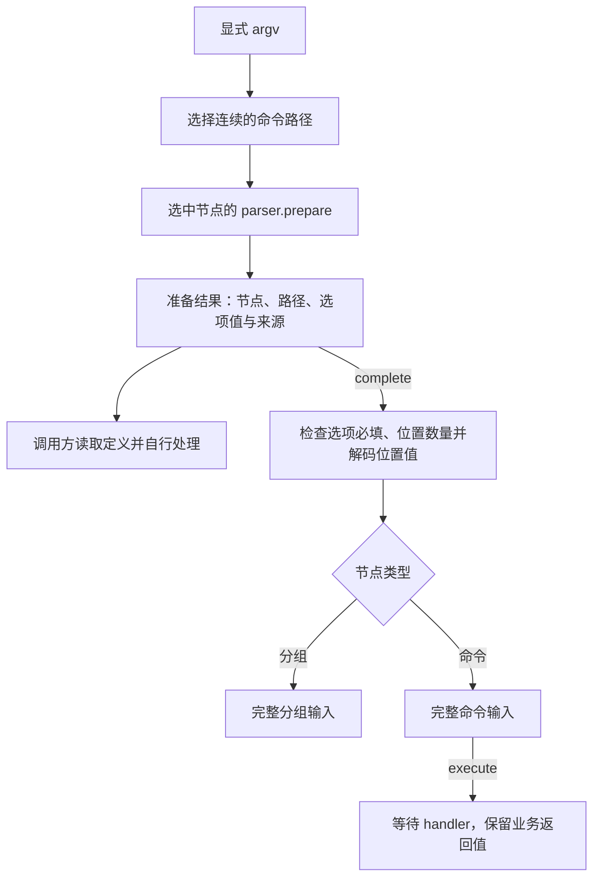

# 架构与职责

Argvia 用一份命令定义连接解析规则、类型推导、结构化读取与调用。parser 提供独立的选项解析能力，core 在此基础上组织命令树和调用阶段。

## 职责

| 层次     | 职责                                                                    |
| -------- | ----------------------------------------------------------------------- |
| parser   | 选项识别与绑定、值协议、默认值、重复归约、来源记录和选项必填检查        |
| core     | 命令定义、显式路径选择、命名位置参数、定义快照、调用阶段与 handler 执行 |
| 应用     | 声明共享、帮助与版本响应、配置合并、领域规则及依赖注入                  |
| 宿主适配 | argv、cwd、环境变量、真实 I/O、信号、退出状态和资源清理                 |

core 通过公开包名依赖 parser，parser 不依赖 core。位置参数复用 parser 的值协议，不另建一套转换机制。两个包的普通入口不读取进程全局或加载 Node 内建模块，`types: []` 约束保持宿主独立。

宿主能力的发布位置由独立消费、依赖和平台需求决定。当前应用可以通过闭包注入业务与宿主服务；开发工具链使用 Node 不构成运行时支持范围的承诺。

## 定义模型

`createCommand` 创建带 handler 的叶子命令，`createGroup` 通过子节点数组创建分组。分组可以声明本地选项；每个节点的选项作用域独立。共享字段采用普通模块和声明复用，不产生运行时继承。

节点的 `definition` 是只读的结构化快照，包含名称、描述、普通元数据、字段规则、解析配置及子节点描述。它不携带 handler，也不执行回调来推断值域。完整路径属于一次调用，同一节点可以被不同分组复用。

定义中包含值解析器和类型化默认值，因此它是程序内可读取的模型，不承诺 JSON 序列化。容器及回调引用固定；元数据中的对象、默认对象和回调返回值保持原引用。

## 调用过程

路由只识别命令路径前缀。到达叶子、输入结束或遇到以 `-` 开头的元素后，剩余输入由选中节点的 parser 处理。选项之后的字符串不再作为子命令重新路由。

准备阶段完成选项绑定与值解析，暂不检查必填与位置约束。调用方可以检查已绑定事实并自行处理，也可以继续完成同一次调用。完成阶段缓存成功或失败，不重复解析；每次执行完整命令则独立调用 handler。

节点上的 `parse(argv)` 是准备并完成的便捷入口，`execute(argv)` 在完成后继续执行。分组输入可以被准备和完成；要求执行分组时产生 `MissingCommand`。

## 描述与应用能力

帮助、版本、检查命令等功能消费同一套公开能力：读取定义，声明普通选项，在执行约束之前检查输入，决定是否继续。core 不注册特定选项名，也不决定这些功能的优先级、显示方式或输出位置。

应用需要展示的枚举候选、说明和其他信息应显式声明。任意 `parse` 回调的值域不能被自动反推，任意默认对象也不会自动转换成展示文本。后续便捷能力应复用定义与调用阶段。

## 来源与类型

所有值都能关联到显式提供状态与来源记录。缺席、类型化默认值和合法的 `undefined` 分开表达。core 将选中节点的来源坐标关联到本次入口收到的完整 argv；命令路径另用 `path` 表示。

准备态中的必填选项仍可能缺席，完成后才取得完整输入类型。叶子 handler 的输入和返回值由声明推导；分组返回可能被选中的节点联合。内联和共享元组保留精确类型，动态定义保持保守推导。

## 代码导航

| 模块                                                       | 职责                           |
| ---------------------------------------------------------- | ------------------------------ |
| [parser/parser.ts](../packages/parser/src/parser.ts)       | 注册表、扫描绑定、准备与完成   |
| [parser/values.ts](../packages/parser/src/values.ts)       | 值协议校验、回调快照与组合器   |
| [core/definition.ts](../packages/core/src/definition.ts)   | 字段规则和元数据快照           |
| [core/input.ts](../packages/core/src/input.ts)             | 节点本地输入的编译与分阶段处理 |
| [core/command.ts](../packages/core/src/command.ts)         | 命令阶段与 handler 调用        |
| [core/group.ts](../packages/core/src/group.ts)             | 分组模型与路径选择             |
| [core/arguments.ts](../packages/core/src/arguments.ts)     | 命名位置参数的固定分配与解码   |
| [core/coordinates.ts](../packages/core/src/coordinates.ts) | 来源与输入错误的原始坐标       |
| [core/lifecycle.ts](../packages/core/src/lifecycle.ts)     | 调用输入快照与完成结果缓存     |
| [core/types.ts](../packages/core/src/types.ts)             | 定义、阶段、来源和结果类型     |

内部模块按职责组织，公开接口见[接口模型](interfaces.md)，完整行为见[命令契约](../packages/core/docs/command-contract.md)。
