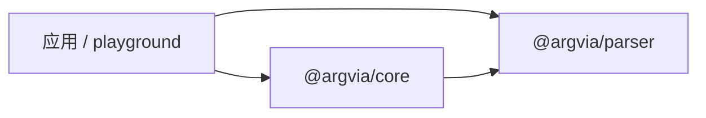

# 架构

Argvia 由独立的选项解析器和基于它的命令组合库构成。应用通过公开包入口使用这些能力。

## 职责与依赖

| 范围                                   | 职责                                                         |
| -------------------------------------- | ------------------------------------------------------------ |
| [parser](../packages/parser/README.md) | 识别与绑定选项，转换值，归约重复输入，记录来源               |
| [core](../packages/core/README.md)     | 选择命令节点，组织本地选项和位置参数，提供定义读取与调用阶段 |
| [应用](../playground/README.md)        | 组合命令，处理应用控制逻辑，连接业务服务与运行环境           |

core 使用 parser 的公开接口解析选项，并复用其值协议解码位置参数。parser 可以单独使用。库之间的引用采用包名，库内实现采用相对路径。

应用将 argv 传给 core。core 选定节点后，将该节点的输入交给 parser，再按位置参数声明处理剩余元素。完整输入传给 handler，结果交回应用。

两个库的普通入口只处理显式传入的数据。进程参数、输出、退出状态和其他 I/O 由应用入口负责；业务服务可以通过闭包注入命令处理函数。

## 工作区结构

`packages/*` 存放库，`playground/*` 存放应用示例。库的公开入口为 `src/index.ts`，实现与测试分别位于 `src` 和 `tests`。示例通过公开入口消费库，应用测试放在示例包内。

## 文档归属

- 根 README 提供项目入口；根 docs 说明架构、工程约定和参考来源。
- 包 README 说明本包用法，包内 docs 定义行为契约及实现分析。
- playground 说明应用的运行方式、行为和代码组织。
- 源码注释解释接口语义与实现中的必要约束。

依赖关系在根架构中说明。包文档涉及依赖接口时链接其契约，具体规则由所属包维护。
